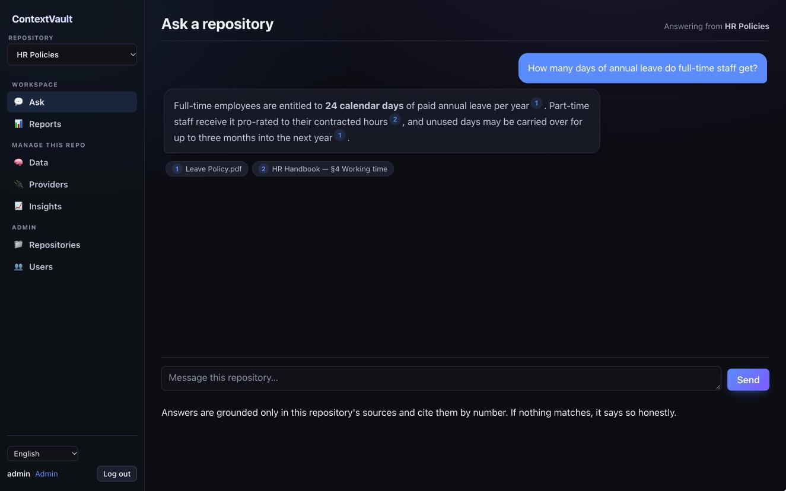
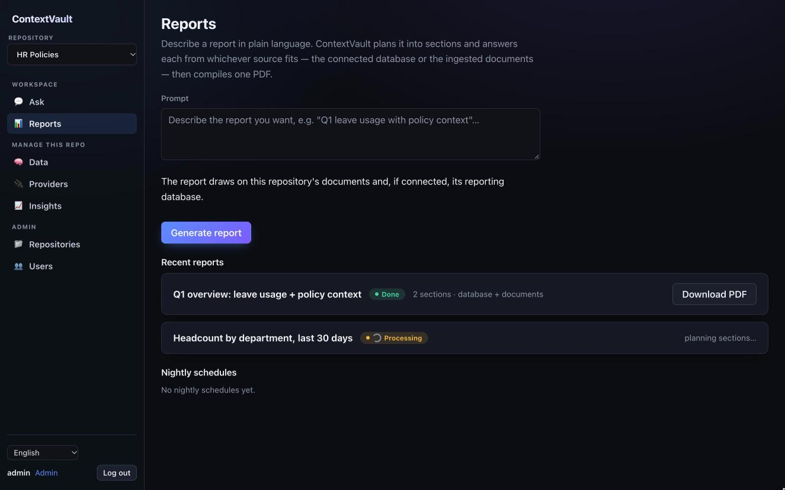
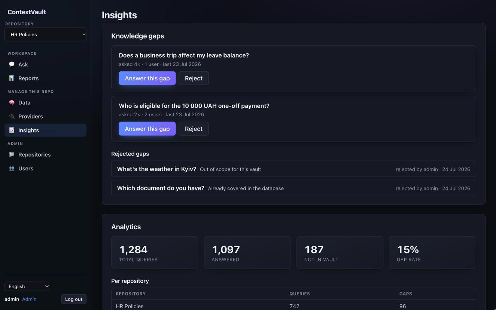
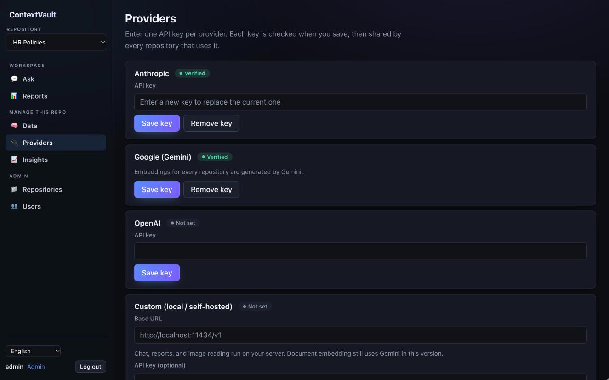
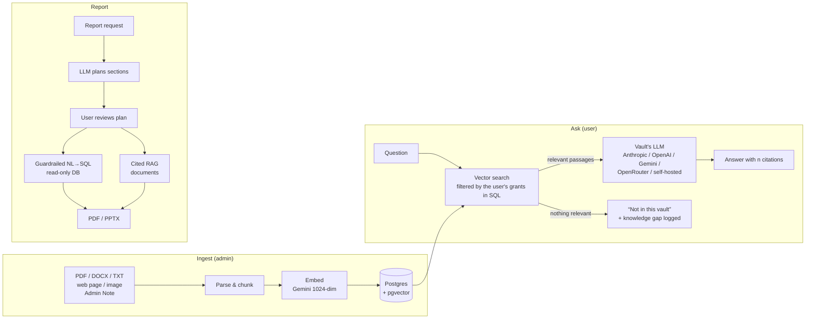

# ContextVault

**A private, NotebookLM-style knowledge assistant for teams.** Admins load documents into
separate vaults, users ask questions in plain language, and every answer comes back with
numbered citations to the exact source. If the answer isn't in the documents,
ContextVault says so instead of making something up.




---

## Why it exists

Most internal chatbots fail in the same three ways:

1. **They make things up.** ContextVault answers *only* from retrieved passages, cites
   each claim, and says "not in this vault" when retrieval finds nothing relevant.
2. **They leak.** Each user sees only the vaults they've been granted, and that rule is
   enforced in the SQL query itself, not in application code on top.
3. **Nobody knows what's missing.** Every question the vault couldn't answer becomes a
   *knowledge gap* on an admin dashboard, so the content gets better over time.

## Features

### Answers you can trust
- **Cited answers.** Every response carries `[n]` markers linked to the source passage.
  Click one to read the original text.
- **Honest "not in this vault"** when nothing relevant is found. The question is logged
  as a gap instead of being answered with a guess.
- **Conversation memory** stored on the server, restored on reload, and clearable.

### Any model, per vault
- **Anthropic, OpenAI, Google Gemini, OpenRouter**, or any **self-hosted
  OpenAI-compatible server** (Ollama, vLLM, LM Studio, …).
- Each vault picks its own provider and model, so a legal vault and an HR vault can
  run on different LLMs.
- API keys are verified when saved and **encrypted at rest** (Fernet).

### Many kinds of sources
- PDF, DOCX and TXT documents, web pages, images (text extracted by the vault's model),
  and **Admin Notes**: short verified answers an admin writes directly.
- The pipeline parses, chunks, embeds (Gemini `gemini-embedding-001`, 1024-dim,
  multilingual) and stores everything in **Postgres + pgvector**.

### Reports from documents *and* databases


- Describe a report in plain language. The model **plans it into sections and shows the
  plan for review before anything runs**: edit, reorder, delete or add sections and
  choose for each one whether it comes from the documents or the database.
- Database sections run through **guardrailed NL→SQL** against a connected read-only
  PostgreSQL or MySQL database. Generated SQL is validated at the AST level, and writes
  and slow queries are rejected.
- Output is a **PDF or PPTX** with charts, stats and per-section citations. A
  **design workbench** lets you edit text directly on the page, restyle the report
  with 5 templates, and **schedule** it to regenerate nightly.

### Admin & access control


- Users ↔ vaults is a many-to-many **grant table**, optionally time-limited.
- Invitations, admin-issued password recovery, and account deletion that anonymizes the
  user's question history instead of erasing analytics.
- **Insights:** a ranked knowledge-gap list (answer it with an Admin Note, or reject it
  with a reason) plus usage analytics per vault.
- The UI is available in **English and Ukrainian**.



## How it works



A deeper walkthrough of every subsystem and endpoint is in
[`docs/architecture.md`](docs/architecture.md). With the server running, the interactive
API reference is at `/docs` (Swagger).

## Tech stack

| Layer | Tools |
|---|---|
| **Backend** | Python 3.12, FastAPI (async), SQLAlchemy 2 (async) + Alembic, Pydantic v2 |
| **Data** | PostgreSQL + pgvector |
| **AI** | Anthropic, OpenAI, Gemini (generation + embeddings), OpenRouter, OpenAI-compatible self-hosted models |
| **Security** | Argon2 password hashing, JWT auth, Fernet encryption for stored secrets, SQL-level access filtering |
| **Frontend** | React, TypeScript, Vite, react-router, i18next |
| **Quality** | pytest, Vitest + Testing Library, Playwright e2e, ruff, mypy, ESLint, Prettier, GitHub Actions |
| **Deploy** | One Docker image serving the SPA and the API, Heroku guide included |

## By the numbers

| | |
|---|---|
| API endpoints | 69 |
| Backend tests (pytest) | 1,297 |
| Frontend unit tests (Vitest) | 393 |
| End-to-end specs (Playwright) | 9 |
| Database migrations | 23 |

CI runs lint, type checks, migrations, the backend suite against a real pgvector
database, the frontend suite and build, and the Playwright e2e on every push to `main`
and every pull request.

## Quick start

**You need:** [uv](https://docs.astral.sh/uv/), Docker, and Node.js.

```bash
uv sync               # backend dependencies (uv installs Python 3.12 if needed)
cp .env.example .env
./dev.sh              # database + migrations + seeded admin + backend + frontend
```

Then open **http://localhost:5173** and sign in as `admin` / `adminpass123` (change it with
`ADMIN_USER=me ADMIN_PASS=secret ./dev.sh`). The API docs are at
http://localhost:8000/docs.

To try a vault, go to **Providers** and add a Gemini key (it's used for embeddings), then
create a repository, upload a document, and ask it something.

Want to see the UI without installing anything? Open
[`contextvault-demo.html`](contextvault-demo.html) in a browser. It's a self-contained,
static click-through of the app with sample data.

<details>
<summary>Run the pieces manually</summary>

```bash
docker compose up -d                            # Postgres + pgvector
uv run alembic upgrade head                     # apply migrations
uv run uvicorn contextvault.main:app --reload   # API on :8000

cd frontend && npm install && npm run dev       # SPA on :5173 (proxies /api to :8000)
```

Create the first admin with
`uv run python -m contextvault.cli create-admin --username admin --password '<strong>'`.
</details>

## Configuration

Settings come from environment variables or `.env` (see [`.env.example`](.env.example)).

| Variable | What it does |
|---|---|
| `DATABASE_URL` | Async Postgres connection string (the default matches `docker compose`). |
| `SECRET_KEY` | JWT signing secret. Use a strong value (≥ 32 bytes) in production. |
| `ENCRYPTION_KEY` | Fernet key that encrypts provider API keys and database passwords at rest. `./dev.sh` creates one for you. |
| `EMBEDDING_MODEL` / `EMBEDDING_DIM` | Embedding model (default `gemini-embedding-001`) and its vector width (1024). |

LLM providers, models and keys are configured in the admin UI, not in the environment.

## Project structure

```
src/contextvault/
  api/          FastAPI routers (auth, users, repositories, grants, sources, query, reports, …)
  core/         config, password hashing, encryption, JWT
  models/       SQLAlchemy models
  retrieval/    access-filtered vector search
  llm/          provider interface, providers, citations, OCR
  services/     ingestion, conversations, knowledge gaps, analytics, report pipeline
migrations/     Alembic migrations
frontend/       React + Vite + TypeScript SPA (unit tests next to components, e2e in frontend/e2e)
tests/          pytest suite
docs/           architecture and deployment guides
```

## Development

```bash
make help          # every target
make test          # the same gates CI runs: backend + frontend
make test-e2e      # Playwright, with ./dev.sh running in another terminal
make fmt           # format backend (ruff) and frontend (prettier)
```

DB-backed tests need Postgres running and migrated (`make db`). Tests ignore your local
`.env`, so a local override can't change a result.

## Deployment

The `Dockerfile` builds a single image that serves the SPA and the API from one origin.
[`docs/deployment.md`](docs/deployment.md) walks through deploying it to Heroku and lists
every config variable. The same image runs on any container host.

## License

© 2026 Artem Levkovich. All rights reserved. The source is published as a portfolio piece.
If you'd like to use it, get in touch.
